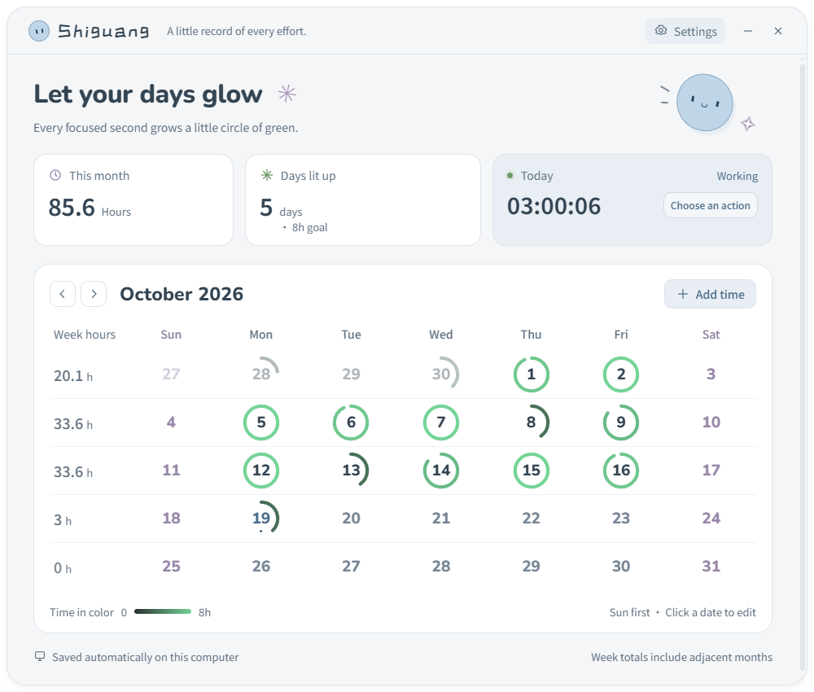

<div align="center">


# Shiguang · 拾光

### A little work orb. A calendar that grows with your time.

A playful, local-first desktop companion for tracking personal work hours on Windows.

**[Download](https://github.com/HoshiTakyobu/shiguang/releases/latest) · [简体中文](README.md) · [Changelog](CHANGELOG.md)**

</div>



## Features

- Click the blue orb to clock in. While working, click to split it diagonally into two smiling companions: coral **Take a break** at the upper right and blue **Clock out** at the lower left. While paused, choose green **I'm back** at the upper left or blue **Clock out** at the lower right. Breaks do not count toward work time.
- Drag the orb to either screen edge to shrink it into a tiny peeking companion, with only one quarter showing and eyes following your cursor. Click or drag it out to restore it.
- Double-click to open this month's calendar without changing the work status.
- Watch today's cumulative `HH:MM:SS` update live, capped at `24:00:00` per day. Sessions crossing midnight are split by local date; weekly and monthly totals may exceed 24 hours.
- Clockwise date rings start at 12 o'clock and grow greener toward your daily goal, eight hours by default. Dates with no work have no ring.
- Choose any day as the start of your week. Weekly totals follow that choice, including dates across month boundaries. Monthly totals and completed days are shown separately.
- Add missing time or correct a day's total, including while today's timer is active.
- Three themes, a configurable ring target, Windows login startup, data relocation and backup export.
- Switch between English and Simplified Chinese in settings. Offline operation with bundled fonts; no account or cloud service.
- One production instance per computer, even when launched from another folder.

<p align="center">


</p>

Click either half to choose. The center cross, Escape, or clicking another window dismisses the desktop choices without changing your status. The calendar uses the same split-orb controls.

## Install

Download from [Releases](https://github.com/HoshiTakyobu/shiguang/releases/latest). Requires **Windows 10 / 11, x64**. Node.js is not needed to run a packaged application.

- **`Shiguang-VERSION-Setup-x64.exe`**: recommended installer with a selectable location, shortcuts and Windows uninstall support.
- **`Shiguang-VERSION-Portable-x64.exe`**: run from a permanent folder without installing.
- **`Shiguang-VERSION-Source.zip`**: source code for development.
- **`SHA256SUMS.txt`**: SHA-256 checksums for the release files.

Choose your installation location in the wizard. The default is `%LOCALAPPDATA%\Programs\shiguang-work-orb`. Work records are stored separately in `%APPDATA%\拾光\worklog.json` and survive upgrades. After removing the application, the uninstaller asks whether to delete current records, settings and cache; keeping them is the default. Exported backups and old migration copies stay in place. Settings → Advanced shows both locations. Launch at login is on by default for a first installation; it does not clock you in automatically.

Current builds are unsigned. Windows may show an unknown-publisher or SmartScreen notice. Check the release source and checksum before deciding to run the application. **Hoshi Takyobu** is the author attribution, not a verified signing identity.

## Timing and data

Working time includes lock and sleep time; paused time does not. A pause survives midnight and application restarts. Normal exit saves and clocks out an active session, while preserving pauses. After an abnormal interruption, the previous state resumes; if it was working, the interruption counts. Rings stop growing at the goal, while work time continues up to 24 hours per day, then counts on the next date. Corrections exceeding 24 hours are rejected; existing daily overflows are normalized to 24 hours without removing dates. Weekly and monthly sums remain uncapped. This is a personal time log with editable records.

Settings → Advanced lets you move the data folder or export a backup. Data does not sync between computers. See the [Chinese user guide](docs/USAGE.md) for migration and restore instructions.

## Development and publishing

On Windows with Node.js 22+ (CI uses 24):

```powershell
npm ci
npm start
npm test
npm run test:startup
npm run test:system
npm run test:ui
npm run check:docs
npm run dist
npm run release:prepare
```

The Windows startup regression uses isolated temporary registry entries and removes them afterward. UI tests use temporary data, not your work log. Pushing a matching `vX.Y.Z` tag runs the GitHub release workflow, builds both executables and attaches source and checksums. See [Publishing](docs/PUBLISHING.md) and [Contributing](CONTRIBUTING.md).

## Author and license

Created and maintained by **[Hoshi Takyobu](https://github.com/HoshiTakyobu)**. Released under the [MIT License](LICENSE). See [third-party notices](THIRD_PARTY_NOTICES.md) for bundled runtime and fonts.
