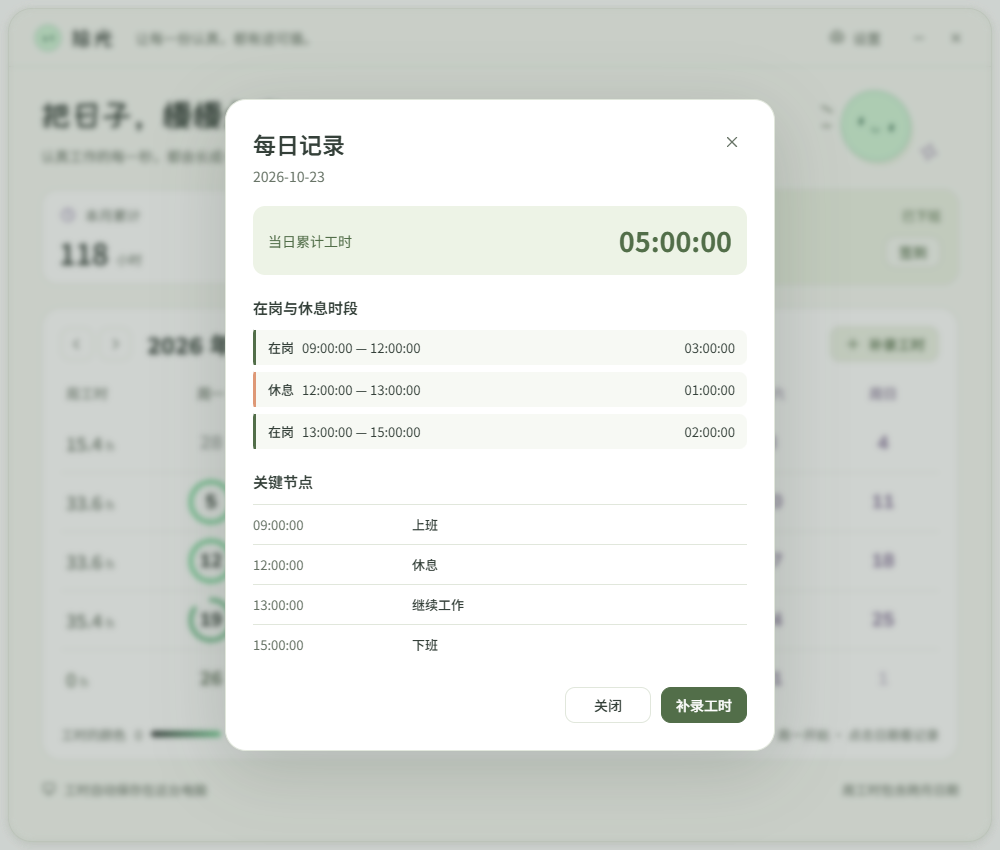
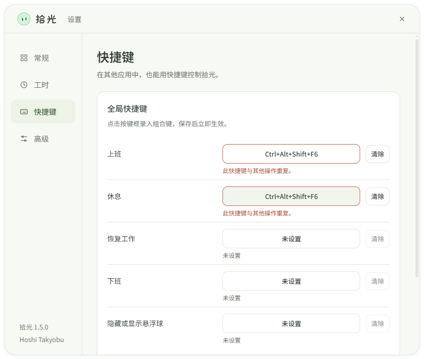

<div align="center">


# Shiguang · 拾光

### A little work orb. A calendar that grows with your time.

A playful, local-first desktop companion for tracking personal work hours on Windows.

**[Download](https://github.com/HoshiTakyobu/shiguang/releases/latest) · [简体中文](README.md) · [Changelog](CHANGELOG.md)**

</div>




<p align="center"><sub>Example: clock in at 09:00, break at 12:00, resume at 13:00, and clock out at 15:00 — 5 hours of work and a 1-hour break.</sub></p>



## Features

- Click the blue orb to clock in. While working, click to split it diagonally into two smiling companions: coral **Take a break** at the upper right and blue **Clock out** at the lower left. While paused, choose green **I'm back** at the upper left or blue **Clock out** at the lower right. Breaks do not count toward work time.
- Drag the orb to either screen edge for a wider peeking companion, exposing about 40 pixels without increasing its height. Eyes follow your cursor. Click or drag it out to restore it. The floating orb stays out of the taskbar and Alt+Tab.
- Set a monthly base goal and add or remove multiple optional Bonus milestones, each with its own hours and estimated monthly income. Defaults are a 160-hour / CNY 800 base and one 200-hour / CNY 1600 Bonus. Hours must increase at each level; total monthly incomes cannot decrease. Progress targets the next unmet milestone. Each amount is the total for that month. Celebrate each milestone once per month; crossing several at once celebrates the highest reached level. Existing single-Bonus settings and reminder history are preserved.
- Optionally connect to your own server and sign in on your phone to see live work time across networks. The read-only page shows last-sync and offline status. See [server setup](cloud/README.md).
- Double-click to open this month's calendar without changing the work status.
- Click a date to see exact clock-in, break, resume and clock-out times, plus work and break intervals split at local midnight.
- Watch today's cumulative `HH:MM:SS` update live, capped at `24:00:00` per day. Sessions crossing midnight are split by local date; weekly and monthly totals may exceed 24 hours.
- Clockwise date rings start at 12 o'clock and grow greener toward your daily goal, eight hours by default. Dates with no work have no ring.
- Choose any day as the start of your week. Weekly totals follow that choice, including dates across month boundaries. Monthly totals and completed days are shown separately.
- Choose **Add time** in a daily record or the calendar toolbar to add missing time or correct a day's total, including while today's timer is active. Adjustments preserve the original intervals and record the change in total.
- Three themes, a configurable ring target, Windows login startup, data relocation and backup export.
- Configure global shortcuts for clock in, take a break, resume, clock out, and show/hide the orb in **Settings → Shortcuts**. All are disabled until configured; saving checks for duplicate or unavailable key combinations.
- Switch between English and Simplified Chinese in settings. Offline by default with bundled fonts; phone viewing is an optional connection to your own server.
- One production instance per computer, even when launched from another folder.

<p align="center">


</p>

Click either half to choose. The center cross, Escape, or clicking another window dismisses the desktop choices without changing your status. The calendar uses the same split-orb controls.

To configure a global shortcut, click its input, press a key combination, then save. Clear and save to disable an action. Shortcuts work while another application is focused. If a combination is already assigned or unavailable to Windows, saving fails and the previous bindings stay active. Shiguang cannot identify which other application holds an unavailable combination.

## Install

Download from [Releases](https://github.com/HoshiTakyobu/shiguang/releases/latest). Requires **Windows 10 / 11, x64**. Node.js is not needed to run a packaged application.

- **`Shiguang-VERSION-Setup-x64.exe`**: recommended installer with a selectable location, shortcuts and Windows uninstall support.
- **`Shiguang-VERSION-Portable-x64.exe`**: run from a permanent folder without installing.
- **`Shiguang-VERSION-Source.zip`**: source code for development.
- **`SHA256SUMS.txt`**: SHA-256 checksums for the release files.

Choose your installation location in the wizard. The default is `%LOCALAPPDATA%\Programs\shiguang-work-orb`. Work records are stored separately in `%APPDATA%\拾光\worklog.json` and survive upgrades. After removing the application, the uninstaller asks whether to delete current records, settings and cache; keeping them is the default. Exported backups and old migration copies stay in place. Settings → Advanced shows both locations. Launch at login is on by default for a first installation; it does not clock you in automatically.

Current builds are unsigned. Windows may show an unknown-publisher or SmartScreen notice. Check the release source and checksum before deciding to run the application. **Hoshi Takyobu** is the author attribution, not a verified signing identity.

## Timing and data

Working time includes lock and sleep time; paused time does not. On exit, choose to keep timing or stop. Keeping timing closes the process completely and counts the gap on next launch, including time while the computer was shut down. Paused sessions can stay paused or start timing from exit. Shutdown, restart and sign-out while the app is running still clock you out. Abnormal interruptions stop at the last saved checkpoint. Active time is saved every 15 seconds and on state changes.

Version 1.5.0 adds timestamped events and daily intervals. Older daily totals are preserved, but past clock-in and clock-out times cannot be reconstructed. Manual corrections record the adjustment without inventing work intervals, so the daily total can differ from the sum of recorded intervals. Exported backups include the available details and restore in the off-work state.

Rings stop growing at the goal, while work time continues up to 24 hours per day, then counts on the next date. Corrections exceeding 24 hours are rejected; existing daily overflows are normalized to 24 hours without removing dates. Weekly and monthly sums remain uncapped. This is a personal time log with editable records.

Settings → Advanced lets you move the data folder or export a backup. Data does not sync between computers. See the [Chinese user guide](docs/USAGE.md) for migration and restore instructions.

## Development and publishing

On Windows with Node.js 22+ (CI uses 24):

```powershell
npm ci
npm start
npm test
npm run test:startup
npm run test:shutdown
npm run test:exit
npm run test:monthly
npm run test:cloud
npm run test:phone
npm run test:shortcuts
npm run test:system
npm run test:ui
npm run check:docs
npm run dist
npm run release:prepare
```

The Windows startup regression uses isolated temporary registry entries and removes them afterward. The shutdown regression sends Windows session-end messages to an isolated test process without shutting down Windows. The shortcuts regression exercises native registration, conflicts and key activation. UI tests use temporary data. Pushing a matching `vX.Y.Z` tag runs the GitHub release workflow, builds both executables and attaches source and checksums. See [Publishing](docs/PUBLISHING.md) and [Contributing](CONTRIBUTING.md).

## Author and license

Created and maintained by **[Hoshi Takyobu](https://github.com/HoshiTakyobu)**. Released under the [MIT License](LICENSE). See [third-party notices](THIRD_PARTY_NOTICES.md) for bundled runtime and fonts.
