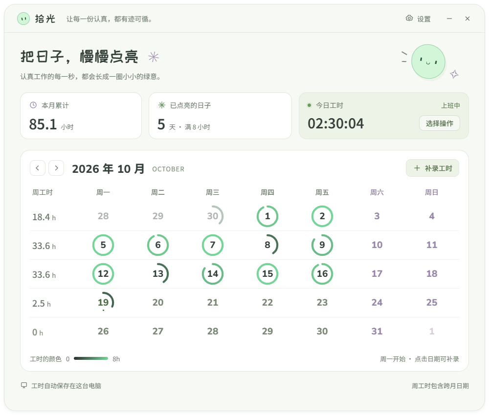
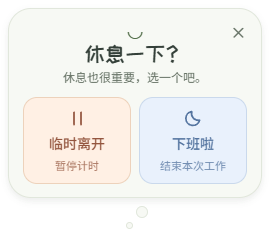
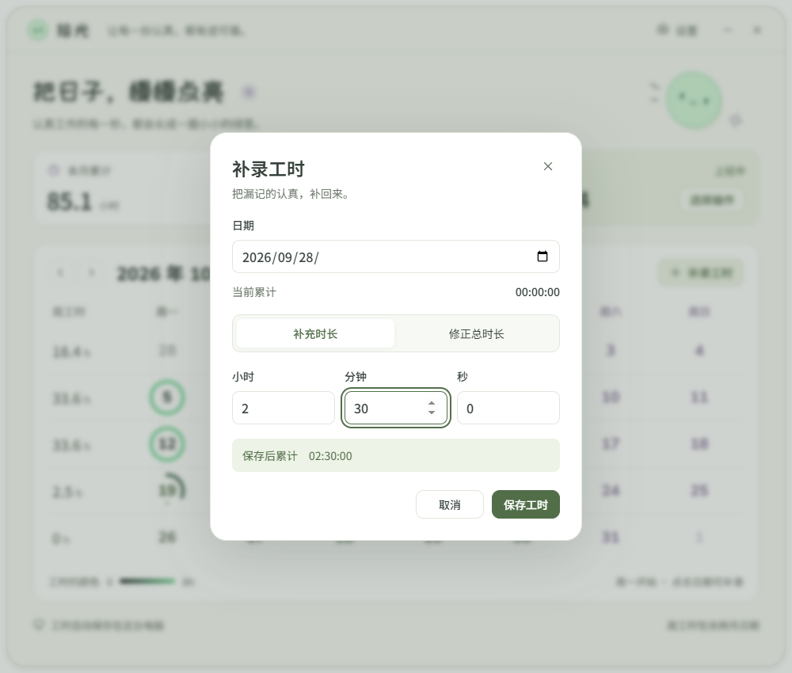
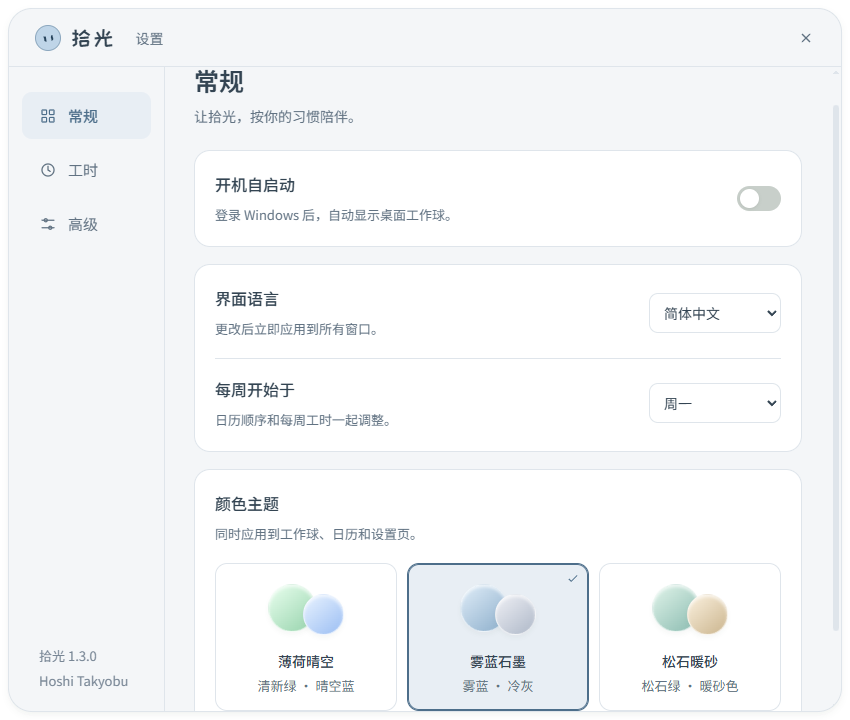

<div align="center">


# 拾光 · Shiguang

### 把日子，慢慢点亮。

一颗住在桌面上的工作球。陪你开始工作，也陪你歇一会儿，让认真度过的时间，长成日历上的一圈绿意。

[](https://github.com/HoshiTakyobu/shiguang/releases/latest)
[](https://github.com/HoshiTakyobu/shiguang/releases)
[](LICENSE)
[](https://www.electronjs.org/)

**[下载安装](#下载安装) · [功能特色](#功能特色) · [开始使用](#开始使用) · [常见问题](#常见问题)**

简体中文 · [English](README.en.md) · [使用手册](docs/USAGE.md) · [更新日志](CHANGELOG.md)


</div>

## 桌面上的一点陪伴

拾光是一个 Windows 桌面工时小工具：可以拖动、始终置顶，整个球面都能点击。双击球体，就能看到这个月的工作日历。

把它拖到屏幕左侧或右侧，它会缩成一只小小的探头球，只露出四分之一，目光跟着鼠标转动。点击或拖出边缘，就会恢复原来的大小。

没有账号，没有云端同步；工时保存在自己的电脑上，字体也随应用内置，日常使用无需联网。



<p align="center"><sub>界面预览使用示例工时。零工时的日期保持干净，开始工作才会出现圆弧。</sub></p>

## 下载安装

前往 **[Releases 下载最新版](https://github.com/HoshiTakyobu/shiguang/releases/latest)**。支持 **Windows 10 / 11，x64**，不需要安装 Node.js。

| 文件 | 适合谁 | 使用方式 |
| --- | --- | --- |
| `Shiguang-版本号-Setup-x64.exe` | 日常使用，推荐 | 跟随安装向导，可选择安装位置，自动创建快捷方式，支持系统卸载。 |
| `Shiguang-版本号-Portable-x64.exe` | 想先试用或免安装使用 | 放到固定文件夹，双击运行；第一次启动会短暂解压。 |
| `Shiguang-版本号-Source.zip` | 想查看或修改源码 | 解压后按下方开发说明运行。 |
| `SHA256SUMS.txt` | 校验下载文件 | 对照 SHA-256 校验值。 |

安装版默认位于 `%LOCALAPPDATA%\Programs\shiguang-work-orb`，工时独立保存在 `%APPDATA%\拾光`。在 **设置 → 高级 → 程序安装位置** 可以直接定位程序；卸载请使用 Windows 的“已安装的应用”。

当前安装包没有购买代码签名证书，Windows 可能显示“未知发布者”或 SmartScreen 提示。请核对下载来源及校验值后自行决定是否运行。软件署名为 **Hoshi Takyobu**，署名不等同于数字签名认证。

## 功能特色

| 功能 | 说明 |
| --- | --- |
| 🟢 工作、休息、收工 | 蓝色签到，绿色工作，暖橙红色暂停。工作中单击弹出气泡，选择临时离开或下班；休息时间不计入工时。 |
| 🫣 贴边偷看 | 拖到屏幕左右边缘缩小藏起，只露出小球的四分之一，眼睛跟随鼠标；点击或拖出恢复。 |
| 📅 会慢慢长大的日历 | 从 12 点钟方向顺时针绘制进度，工时越长越接近清新绿，默认 8 小时闭合。 |
| 🕒 每周与每月汇总 | 每周起始日可从七天中任选，周工时按对应日期范围统计，包含跨月日期。 |
| ✍️ 忘记签到也能补录 | 点击日期补充工时或修正总时长，精确到秒；今日计时可继续。 |
| 🎨 三套配色 | 薄荷晴空、雾蓝石墨、松石暖砂，同时应用于球体、日历与设置。 |
| ⚙️ 按自己的节奏设置 | 自定义圆环目标，管理登录自启动，查看或迁移数据目录，导出备份。 |
| 🌐 中英双语 | 在设置中即时切换简体中文与 English，覆盖工作球、气泡、日历、设置和托盘菜单。 |
| 💾 数据留在本机 | 自动保存、最近有效备份与异常恢复。升级保留记录；卸载完成后可选择是否删除当前数据，默认保留。 |
| 🔒 只陪伴一份 | 同一台电脑只运行一个正式拾光实例，重复打开会回到已有应用。 |

<details>
<summary><strong>看看补录与设置界面</strong></summary>







</details>

## 开始使用

1. 安装并打开拾光，桌面上会出现蓝色工作球。
2. **单击蓝色球体**签到，球体变为绿色，实时显示当天累计 `HH:MM:SS`。
3. **工作中单击**弹出小气泡，选择“临时离开”暂停，或“下班啦”签退。暂停后可选择继续工作，接着累计。
4. **双击**球体查看本月日历；左上角箭头翻月，点击日期补录工时。
5. **按住拖动**调整位置，拖到左右边缘缩小藏起；**右键**打开菜单。隐藏后可从系统托盘找回。

首次运行默认开启 **Windows 登录后自启动**，不会自动签到。可以在“设置 → 常规”关闭，也可在这里选择语言和每周起始日。已有用户的开关选择会保留。

为区分单击与双击，单击会等待系统的双击判定时间，通常约半秒；双击查看日历不会触发签到或签退。

## 常见问题

**睡眠、锁屏和退出时如何计时？**

工作状态下，锁屏和睡眠会继续计入；“临时离开”会暂停累计，跨日或重启都不会把休息算入工时。正常退出时，工作中的会话自动签退，暂停状态保留。异常中断后，会从上次保存的状态恢复；如果当时仍在工作，中断时间也会算入。每天按本机时区的午夜拆分。[完整计时规则](docs/USAGE.md#计时规则)

**工时文件在哪里？重装会丢吗？**

默认记录是 `%APPDATA%\拾光\worklog.json`。安装目录与记录目录分开，升级保留记录。卸载程序会在移除软件后询问是否删除当前记录、设置和缓存，默认选择保留；导出的备份和迁移时留下的旧副本不会删除。支持在“设置 → 高级”迁移和导出；换电脑需要自行复制记录，不会自动同步。[数据与备份说明](docs/USAGE.md#本地数据)

**开机没有出现工作球？**

在“设置 → 常规”关闭后重新开启自启动，再检查 Windows“启动应用”中的拾光是否被暂停。免安装版移动后，需要手动运行一次来更新路径。安装版使用固定路径，适合长期使用。

**一天超过目标会怎样？**

圆环保持闭合，真实工时继续累计。目标可设为 1 分钟至 24 小时；修改目标会更新所有月份的显示，不会改写已有工时。

**可以当公司考勤系统使用吗？**

拾光面向个人记录，允许手动补录，没有企业考勤、审批或团队管理功能。

## 本地开发

需要 **Windows、Node.js 22 或更新版本、npm**。持续集成使用 Node.js 24。

```powershell
npm ci
npm start
```

```powershell
npm test                 # 计时、存储和设置
npm run test:startup     # 真实 Windows 启动项回归，使用独立测试项并清理
npm run test:system      # 单实例互斥与卸载清理，使用隔离测试目录
npm run test:ui          # Electron 界面与持久化检查，使用隔离数据
npm run check:docs       # 文档资源与发布信息检查
npm run dist             # 构建安装版与免安装版，不会自动上传
npm run release:prepare  # 生成源码 ZIP、校验文件与 Release 说明
```

源码采用 Electron + HTML / CSS / JavaScript。窗口启用上下文隔离与沙箱，只加载本地页面。开发和界面测试不会改动正式应用的自启动项。

在另一台电脑上传仓库、发布 Release 或让 GitHub 自动打包，请看 **[发布指南](docs/PUBLISHING.md)**。欢迎通过 [Issues](https://github.com/HoshiTakyobu/shiguang/issues) 反馈问题，提交修改前请阅读 [贡献指南](CONTRIBUTING.md)。

## 作者与许可

由 **[Hoshi Takyobu](https://github.com/HoshiTakyobu)** 制作与维护，采用 **[MIT License](LICENSE)** 开源。

感谢 Electron、Noto Sans SC、Nunito 与站酷快乐体。第三方许可见 [THIRD_PARTY_NOTICES.md](THIRD_PARTY_NOTICES.md)。
